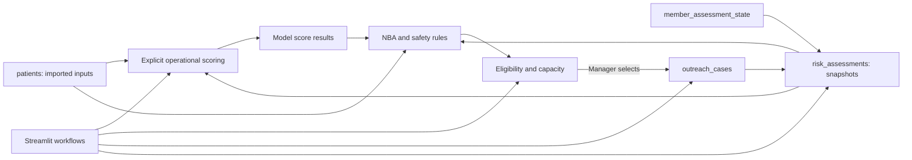
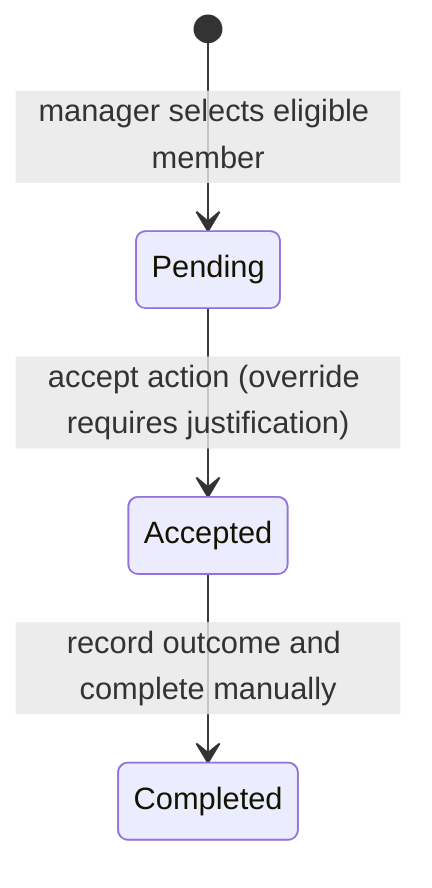

# Milestone 3 — Technical Architecture and Operational Workflows

This document describes the **planned** workflow. The existing application
and open proposals are distinguished below; see the [project plan](README.md)
for issue status and implementation order.

## System Architecture

Python ETL imports the synthetic survey into SQLite `patients`. Python ML
components train and compare Logistic Regression, Random Forest, and XGBoost;
current scoring writes replaceable `<model>_scores` tables. Streamlit currently
displays member records, model evaluation, and risk scoring. See the existing
[database](../milestone-1/database.md) and [risk-scoring](../risk-scoring.md)
documentation for details.

| Component | Responsibility and status |
| --- | --- |
| `patients` and `<model>_scores` | Existing source records and replaceable model results; merged [#44](https://github.com/jonpauljah/mh-risk-outreach/pull/44) protects populated imports. |
| `risk_assessments` | Historical input and scoring snapshots; storage proposed in open [#45](https://github.com/jonpauljah/mh-risk-outreach/pull/45). |
| `member_assessment_state` | Reference to the latest submitted assessment, potentially pending; proposed in #45. |
| `outreach_cases` | Case, originating assessment, recommendation, decisions, and outcome; storage proposed in #45. |
| Scoring | Existing model scoring; planned operational selection, versioned boundaries, and assessment integration in [#34](https://github.com/jonpauljah/mh-risk-outreach/issues/34)–[#35](https://github.com/jonpauljah/mh-risk-outreach/issues/35). |
| NBA and eligibility | Planned deterministic action rules, safety routing, capacity, and transactional eligibility checks in [#36](https://github.com/jonpauljah/mh-risk-outreach/issues/36)–[#37](https://github.com/jonpauljah/mh-risk-outreach/issues/37). |
| Case lifecycle and UI | Planned transition policy and Streamlit integration in [#38](https://github.com/jonpauljah/mh-risk-outreach/issues/38)–[#42](https://github.com/jonpauljah/mh-risk-outreach/issues/42). #45 provides persistence operations, not the complete policy or UI. |

The diagram shows intended responsibilities, not completed integrations. [PR #46](https://github.com/jonpauljah/mh-risk-outreach/pull/46)
is open: it removes safety flags from predictors and reevaluates the three models
while retaining the existing safety override; it does not select an operational model.

## Risk Scoring and Assessment Workflow

1. A manager explicitly triggers population-wide scoring. One selected,
   identifiable operational model will serve outreach; all three remain available
   for comparison. Five ordered model-derived bands, Very Low through Very High,
   need saved boundaries per model version for repeatable individual assignment.
   Historical ranks retain their cohort context. Existing batch K-means and its
   safety-forced Very High priority do not yet meet this separation or stability
   requirement; see [#34](https://github.com/jonpauljah/mh-risk-outreach/issues/34).
2. Safety flags remain independent inputs for human review, even for a low model
   band. They must use the latest member inputs, including a pending assessment.
3. Until a first case is created, a member uses `patients` and operational score
   results; scoring all 10,000 members must not create 10,000 assessment rows.
   First case creation saves a baseline and case together. Open #45 implements
   this using a supplied scoring result.
4. A deliberate manual reassessment appends a full immutable input snapshot and
   advances the current reference without changing `patients` or past cases.
   It may remain `PendingScoring` until the next explicit scoring run. New inputs
   must not be labeled with an older assessment's score. The open #45 persistence
   layer finalizes only the latest pending assessment with a supplied result;
   the scoring orchestration is still planned. Earlier pending snapshots remain
   history if superseded before scoring.

**Issue wording to update:** [#41](https://github.com/jonpauljah/mh-risk-outreach/issues/41)
currently specifies immediate recalculation and atomic scored submission. Open
#45 takes precedence: submission and scoring finalization are separate, with
scoring initiated by an explicit manager-triggered run.
[#35](https://github.com/jonpauljah/mh-risk-outreach/issues/35) also refers to a
qualifying operational current assessment; its wording needs alignment with the
current pointer advancing to pending inputs. The planned UI and eligibility
policy must distinguish pending inputs from the last scored result, and pending
safety signals must remain visible throughout.

## NBA Recommendation Workflow

For a member without assessment history, planned rules use `patients` inputs and
structured evidence from operational scoring. For an assessed member they use
the latest applicable assessment inputs and scoring information, clearly marking
when current inputs await scoring. Rules produce one actionable recommendation,
an explanation, and a rule version. Safety concerns take precedence; configurable
thresholds and tie-breaking require domain validation. Structured model evidence
can inform rules, but display text is not parsed as an input and SHAP is not
causal evidence. See [#36](https://github.com/jonpauljah/mh-risk-outreach/issues/36).

The intended history preserves recommendation and version alongside assessments
and cases. A recommendation alone never creates a case. Open #45 stores supplied
recommendation data but does not generate it; its pending assessment schema
currently does not store a recommendation until scoring is finalized. How to
display or preserve a safety recommendation while scoring is pending remains an
integration decision.

## Outreach Eligibility and Capacity

The planned [#37](https://github.com/jonpauljah/mh-risk-outreach/issues/37)
policy separates **Safety Review** from **Standard Outreach**. Safety concerns
remain visible regardless of band or capacity. Standard candidates are unflagged,
High or Very High on the current applicable model assessment, and have no active
case. Managers select candidates; the service rechecks eligibility, freshness,
capacity, and duplicate active cases atomically at creation.

Configurable shared capacity **K** counts all Pending and Accepted cases. Standard
slots are `max(0, K - active cases)`; necessary safety cases may exceed K under
the safety exception. A completed case releases its slot, but repeat standard
outreach requires a newer qualifying manual assessment and current eligibility;
preview-only demo edits do not qualify. Open #45 requires a scored current
assessment for a new case: a pending reassessment blocks case creation until an
explicit scoring run finalizes it, even while its safety signals remain visible
for review. The handling of a safety recommendation before scoring remains an
integration decision. The
manager-selected flow also needs the sponsor approval noted in #37.

## Case Lifecycle

The planned policy retains the original recommendation, explanation and versions
even when a manager selects an alternative, recording justification, accepted
action and timestamps. Accepted cases record an outcome before completion;
Completed cases remain in history and are excluded from active work. Completion
does not update survey inputs or risk scores, and reassessment submission does
not close a case. Open #45 stores these fields; enforcing all transitions and
completed-case restrictions belongs to [#38](https://github.com/jonpauljah/mh-risk-outreach/issues/38).

## Streamlit Workflows

All outreach components below are planned; existing model evaluation and risk
scoring pages remain separate.

| View | Intended workflow |
| --- | --- |
| Safety Review / Standard Outreach | Show current context, recommendations, capacity, and errors; managers select cases to create. |
| Active Cases | List Pending and Accepted cases; review the original action, accept or justify an override, record an outcome, and complete manually. |
| Manual reassessment | Edit validated inputs deliberately; named synthetic presets populate the form without submitting or changing eligibility. Show pending status and before/after context. |
| History & Reporting | Read-only overview, searchable completed cases, and exact member ID lookup with assessment and case comparisons; show when no reassessment or score exists. |

## Testing and Integration

- Check SQLite foreign keys, immutable history, duplicate prevention, atomic
  baseline/case creation, reassessment pointer updates, and rollback.
- Verify model feature exclusion, artifact versions, stable bands and consistent
  batch/individual scoring, including unchanged historical rank context.
- Test deterministic NBA precedence, rule versions, independent safety signals,
  and pending-scoring behavior.
- Exercise capacity, safety exceptions, repeat eligibility, stale selections,
  concurrent creation, and valid case transitions.
- Validate Streamlit selection, form errors, presets, refresh, reporting counts,
  comparisons and empty states; confirm imported records and completed history
  survive rescoring and application restarts.

Return to the [Milestone 3 plan](README.md) or [documentation index](../README.md).
