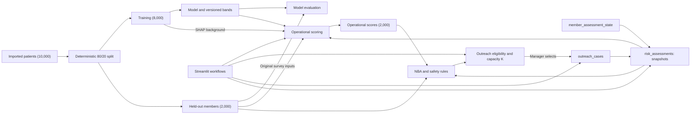
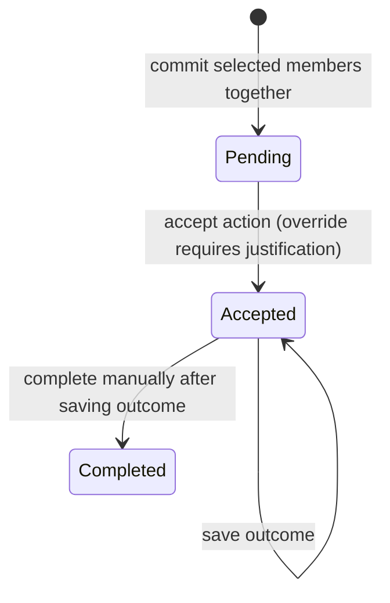

# Milestone 3 — Technical Architecture and Operational Workflows

This document describes the operational scoring and persistence already
available, along with the remaining Milestone 3 workflow. See the
[project plan](README.md) for implementation order.

## System Architecture

Python ETL imports all 10,000 synthetic survey records into SQLite `patients`.
The existing deterministic split provides 8,000 original records for model
training, band fitting, and the SHAP background. The 2,000 held-out IDs define
the evaluation and operational populations. Model evaluation reads original
survey inputs and operational scoring can use updated assessment snapshots.
Comparison scoring writes replaceable `<model>_scores` tables and operational
scoring writes a separate `operational_scores` worklist. Streamlit displays
member records, model evaluation, risk scoring, and Outreach Management. See the
[database](../milestone-1/database.md) and [risk-scoring](../risk-scoring.md)
documentation for details.

| Component | Responsibility and status |
| --- | --- |
| `patients` and `<model>_scores` | Existing source records and replaceable model results; merged [#44](https://github.com/jonpauljah/mh-risk-outreach/pull/44) protects populated imports. |
| `risk_assessments` | Historical input and scoring snapshots. [PR #45](https://github.com/jonpauljah/mh-risk-outreach/pull/45) implemented storage. |
| `member_assessment_state` | Reference to the latest submitted assessment, potentially pending. PR #45 implemented this table. |
| `outreach_cases` | Case, originating assessment, recommendation, decisions, and outcome. PR #45 implemented storage. |
| Scoring | [#34](https://github.com/jonpauljah/mh-risk-outreach/issues/34) provides the operational worklist, saved boundaries, and assessment score payloads. [#35](https://github.com/jonpauljah/mh-risk-outreach/issues/35) connects scoring and assessment persistence for first-case baselines and explicit reassessment finalization. |
| NBA and eligibility | [#36](https://github.com/jonpauljah/mh-risk-outreach/issues/36) provides versioned recommendations with safety precedence. [#37](https://github.com/jonpauljah/mh-risk-outreach/issues/37) supplies safety routing, worklists, and transactional eligibility checks. |
| Case lifecycle and UI | [#38](https://github.com/jonpauljah/mh-risk-outreach/issues/38) provides the lifecycle service. [#39](https://github.com/jonpauljah/mh-risk-outreach/issues/39) adds the worklists and case creation UI. |

The diagram includes planned integrations with operational scoring. Merged
[PR #46](https://github.com/jonpauljah/mh-risk-outreach/pull/46) removed safety
flags from model predictors and reevaluated all three models.

## Risk Scoring and Assessment Workflow

1. A manager explicitly runs the operational scoring CLI to refresh the
   worklist for the 2,000 held-out members. Logistic regression is the configurable
   default. All three models remain available for comparison. The scoring
   paths share the five ordered bands saved with each version. See
   [Risk scoring](../risk-scoring.md) for configuration and ordering.
2. Safety flags use the latest member inputs, including pending
   reassessments. A member can require safety review at any model band.
   Flagged members rank first, followed by descending model score compared at
   10 decimal places and ascending member ID for ties.
3. The current worklist uses imported inputs or the latest finalized
   assessment inputs. Population scoring creates no assessment rows. At
   first case creation, the persistence API saves the baseline, current
   reference, and case in one transaction. It uses a supplied score or
   copies the member's row from the published worklist.
4. A manual reassessment appends a full input snapshot, advances the current
   reference, and stays `PendingScoring` until finalized. A refresh uses prior
   scored inputs for the model and the pending inputs for safety flags.
   Earlier pending snapshots remain in history when superseded.
5. The explicit backend scoring operation finalizes the latest pending
   assessment and publishes an updated 2,000-member worklist in the same
   transaction. The assessment archives the row's score, explanation, band,
   rank, cohort and model metadata, and the generated recommendation. An unused
   scored current assessment with a matching stored action can supply a later case.
   Subsequent refreshes leave those historical snapshots intact. Training,
   evaluation, and membership continue to read the original imported survey.

[#41](https://github.com/jonpauljah/mh-risk-outreach/issues/41) currently
describes immediate recalculation and atomic scored submission. The
implemented persistence contract separates submission from finalization.
The planned UI and eligibility policy need to show the pending inputs,
the last scored result, and any current safety flags.

## NBA Recommendation Workflow

Operational preview returns one action, reason, and rule version alongside the
score. Operational scoring prepares first-case recommendations from the
saved `patients` snapshot. Reassessment finalization uses the pending
snapshot and the same model run for scoring and recommendation. It archives
the recommendation in the assessment, and later cases copy it from their
originating assessment.

The [versioned rules](../risk-scoring.md#outreach-recommendation-rules) give
safety flags precedence across all bands and use structured SHAP contributions
to resolve competing routine actions. The demo cutoffs and tie order require
domain validation. The rules can return safety review with survey inputs alone.
Safety Review shows that recommendation while the current assessment awaits scoring.

## Outreach Eligibility and Capacity

Configure one shared `OutreachPolicy(capacity=K)` for the database. The Streamlit
page reads `MH_RISK_OUTREACH_CAPACITY` at launch and defaults to 100.
`worklists()` returns **Safety Review**, **Standard Outreach**, and the
remaining standard slots. The Streamlit page reads these and the Active Cases
table in one SQLite transaction. Both queues start with the held-out IDs. Safety
Review reads flags directly from the latest saved inputs and can surface an
in-scope concern before a published score is available. A case linked to
those inputs removes that snapshot from the queue. A newer flagged snapshot
appears even while a case for an earlier snapshot is active or the new
snapshot is awaiting scoring.

Standard candidates are unflagged, have no active case, and have a qualifying
High or Very High score in the published cohort for the configured model and
version. Pending and Accepted cases from both queues consume the shared
capacity. The worklist offers the top `max(0, K - active cases)` standard
candidates by current model priority. Safety selections with a current score
can exceed K. A pending assessment's safety flags remain visible while case
creation awaits scoring and any prior active case's completion.

Pass the selected entries to `OutreachPolicy.create_cases(selections)`.
The service rechecks every entry against one worklist snapshot under the
SQLite write lock and returns case IDs in selection order. A stale or
ineligible entry, a duplicate selection, or a failed write rolls back the
whole batch, including its first-case baselines. In a mixed selection,
standard cases fit within the available slots at validation time. Selected
safety cases can take the total above K. `create_case(selection)` uses the
same checks for a single case.

Operational scoring publishes first-case recommendations alongside the scores
in `operational_recommendations`. Older publications fill and save missing
recommendations as needed. The worklist keeps members with a saved
recommendation selectable if another member's recommendation is unavailable.
Case creation reuses the published score and recommendation to save the
first-case baseline. Later cases reuse the recommendation on the finalized
assessment. Completing a case frees a slot.
Repeat standard outreach requires a newer qualifying manual assessment and
continued eligibility. Read-only demo previews leave eligibility unchanged.
The manager-selected flow requires the sponsor approval noted in #37.

If published scores cover a different set of IDs, `requires_score_refresh`
is true. Standard Outreach is empty, and current concerns for held-out members
remain visible in Safety Review while selection is unavailable. See the
[worklist recovery procedure](../risk-scoring.md#recovering-an-existing-database).

## Case Lifecycle

In `mh_risk_outreach.db.outreach`, `select_case_action()` saves a choice while
the case is Pending. An alternative requires a nonblank justification.
Pass the action and justification shown during review as `expected_action`
and `expected_justification` to `accept_case()`. If no action has been selected,
the action for review is the original recommendation. Acceptance compares
both values under the write lock and clears any outcome left on a Pending
case by an older version.
The original assessment link, recommendation, explanation, rule version, and
model version stay available for comparison.

`record_case_outcome()` saves one outcome while Accepted. The manager can
correct it before completion. Supported values are **Not reached**,
**Reached — declined**, **Reached — engaged**, and **Referral completed**.
Pass the outcome shown during review as `expected_outcome` to `complete_case()`.
Completion checks it against the saved outcome under the write lock and freezes
the case decisions. If a reviewed value has changed, refresh the case and
review it again before submitting. SQLite stores UTC timestamps for acceptance,
outcome recording, and completion. Invalid decisions leave the stored case
unchanged.

`list_active_cases()` returns Pending and Accepted cases. `list_member_history()`
includes Completed cases after their capacity slots are released. Reassessment
and case completion are independent operations.

## Streamlit Workflows

Outreach Management is available alongside model evaluation and risk scoring.
Use the [getting-started guide](../../getting-started.md) to publish operational
scores and start the app.

| View | Workflow |
| --- | --- |
| Safety Review / Standard Outreach | Review current context, recommendations, and shared capacity. Submit the selected members in a single batch from either worklist. |
| Active Cases | List Pending and Accepted cases. **Update Case** opens the selected case's details. [#40](https://github.com/jonpauljah/mh-risk-outreach/issues/40) adds the lifecycle controls. |
| Manual reassessment | [#41](https://github.com/jonpauljah/mh-risk-outreach/issues/41) adds validated edits, demo presets, pending status, and before/after context. |
| History & Reporting | [#42](https://github.com/jonpauljah/mh-risk-outreach/issues/42) adds a read-only overview, completed case search, and member assessment comparisons. |

## Testing and Integration

- Check SQLite foreign keys, immutable history, duplicate prevention, atomic
  baseline/case creation, reassessment pointer updates, and rollback.
- Verify model feature exclusion, artifact versions, stable bands and consistent
  batch/individual scoring, including unchanged historical rank context.
- Test deterministic NBA precedence, rule versions, independent safety signals,
  and pending-scoring behavior.
- Exercise capacity, safety exceptions, repeat eligibility, stale selections,
  concurrent creation, and valid case transitions.
- Validate Streamlit selection, form errors, presets, refresh, reporting counts,
  comparisons and empty states; confirm imported records and completed history
  survive rescoring and application restarts.

Return to the [Milestone 3 plan](README.md) or [documentation index](../README.md).
