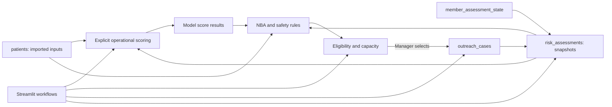
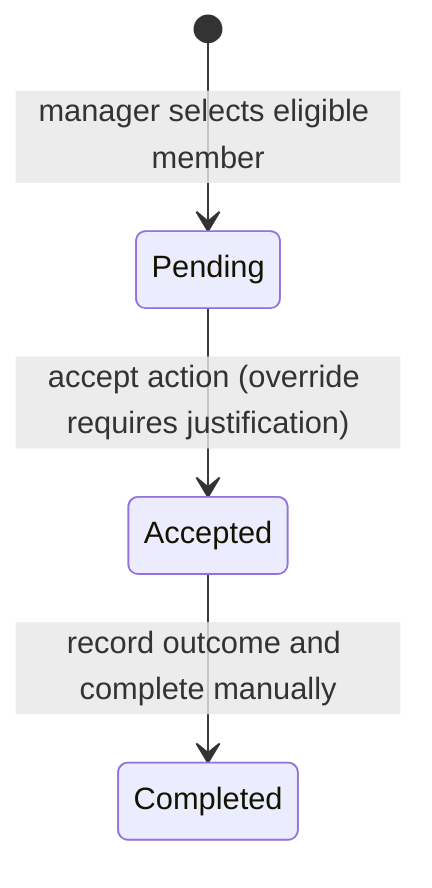

# Milestone 3 — Technical Architecture and Operational Workflows

This document describes the operational scoring and persistence already
available, along with the remaining Milestone 3 workflow. See the
[project plan](README.md) for implementation order.

## System Architecture

Python ETL imports the synthetic survey into SQLite `patients`. Python ML
components train and compare Logistic Regression, Random Forest, and XGBoost;
comparison scoring writes replaceable `<model>_scores` tables and operational
scoring writes a separate `operational_scores` worklist. Streamlit currently
displays member records, model evaluation, and risk scoring. See the existing
[database](../milestone-1/database.md) and [risk-scoring](../risk-scoring.md)
documentation for details.

| Component | Responsibility and status |
| --- | --- |
| `patients` and `<model>_scores` | Existing source records and replaceable model results; merged [#44](https://github.com/jonpauljah/mh-risk-outreach/pull/44) protects populated imports. |
| `risk_assessments` | Historical input and scoring snapshots. [PR #45](https://github.com/jonpauljah/mh-risk-outreach/pull/45) implemented storage. |
| `member_assessment_state` | Reference to the latest submitted assessment, potentially pending. PR #45 implemented this table. |
| `outreach_cases` | Case, originating assessment, recommendation, decisions, and outcome. PR #45 implemented storage. |
| Scoring | [#34](https://github.com/jonpauljah/mh-risk-outreach/issues/34) provides the operational worklist, saved boundaries, and assessment score payloads. [#35](https://github.com/jonpauljah/mh-risk-outreach/issues/35) connects scoring and assessment persistence for first-case baselines and explicit reassessment finalization. |
| NBA and eligibility | [#36](https://github.com/jonpauljah/mh-risk-outreach/issues/36) provides versioned recommendations with safety precedence. Safety routing, capacity, and transactional eligibility checks are planned in [#37](https://github.com/jonpauljah/mh-risk-outreach/issues/37). |
| Case lifecycle and UI | Planned transition policy and Streamlit integration in [#38](https://github.com/jonpauljah/mh-risk-outreach/issues/38)–[#42](https://github.com/jonpauljah/mh-risk-outreach/issues/42). #45 provides the persistence operations. |

The diagram includes planned integrations with operational scoring. Merged
[PR #46](https://github.com/jonpauljah/mh-risk-outreach/pull/46) removed safety
flags from model predictors and reevaluated all three models.

## Risk Scoring and Assessment Workflow

1. A manager explicitly runs the operational scoring CLI to refresh the
   worklist for all imported members. Logistic regression is the configurable
   default. All three models remain available for comparison. The scoring
   paths share the five ordered bands saved with each version. See
   [Risk scoring](../risk-scoring.md) for configuration and ordering.
2. Safety flags use the latest member inputs, including pending
   reassessments. A member can require safety review at any model band.
   Flagged members rank first, followed by descending model score compared at
   10 decimal places and ascending member ID for ties.
3. The current worklist uses imported inputs or the latest finalized
   assessment inputs. Population scoring creates no assessment rows. At
   first case creation, the persistence API saves the baseline, current
   reference, and case in one transaction. It uses a supplied score or
   copies the member's row from the published worklist.
4. A manual reassessment appends a full input snapshot, advances the current
   reference, and stays `PendingScoring` until finalized. A refresh uses prior
   scored inputs for the model and the pending inputs for safety flags.
   Earlier pending snapshots remain in history when superseded.
5. The explicit backend scoring operation finalizes the latest pending
   assessment and publishes an updated population worklist in the same
   transaction. The assessment archives the row's score, explanation, band,
   rank, cohort and model metadata, and the generated recommendation. An unused
   scored current assessment with a matching stored action can supply a later case.
   Subsequent refreshes leave those historical snapshots intact.

[#41](https://github.com/jonpauljah/mh-risk-outreach/issues/41) currently
describes immediate recalculation and atomic scored submission. The
implemented persistence contract separates submission from finalization.
The planned UI and eligibility policy need to show the pending inputs,
the last scored result, and any current safety flags.

## NBA Recommendation Workflow

Operational preview returns one action, reason, and rule version alongside the
score. A first-case caller can preview the `patients` snapshot and explicitly
pass the result into case persistence. Reassessment finalization uses the
pending snapshot and the same model run for scoring and recommendation. It
archives the recommendation in the assessment, and later cases copy it from
their originating assessment.

The [versioned rules](../risk-scoring.md#outreach-recommendation-rules) give
safety flags precedence across all bands and use structured SHAP contributions
to resolve competing routine actions. The demo cutoffs and tie order require
domain validation. The rules can return safety review with survey inputs alone.
Displaying a recommendation while scoring is pending is a later UI integration.

## Outreach Eligibility and Capacity

The planned [#37](https://github.com/jonpauljah/mh-risk-outreach/issues/37)
policy separates **Safety Review** from **Standard Outreach**. Safety concerns
remain visible regardless of band or capacity. Standard candidates are unflagged,
High or Very High on the current applicable model assessment, and have no active
case. Managers select candidates; the service rechecks eligibility, freshness,
capacity, and duplicate active cases atomically at creation.

Configurable shared capacity **K** counts all Pending and Accepted cases. Standard
slots are `max(0, K - active cases)`; necessary safety cases may exceed K under
the safety exception. A completed case releases its slot, but repeat standard
outreach requires a newer qualifying manual assessment and current eligibility;
preview-only demo edits do not qualify. The #45 persistence API requires a
scored current assessment for a new case. A pending reassessment blocks case
creation until scoring finalizes it. Its safety flags still require review.
Handling safety recommendations before scoring remains an integration decision.
The manager-selected flow also needs the sponsor approval noted in #37.

## Case Lifecycle

The planned policy retains the original recommendation, explanation and versions
even when a manager selects an alternative, recording justification, accepted
action and timestamps. Accepted cases record an outcome before completion;
Completed cases remain in history and are excluded from active work. Completion
does not update survey inputs or risk scores, and reassessment submission does
not close a case. Open #45 stores these fields; enforcing all transitions and
completed-case restrictions belongs to [#38](https://github.com/jonpauljah/mh-risk-outreach/issues/38).

## Streamlit Workflows

All outreach components below are planned; existing model evaluation and risk
scoring pages remain separate.

| View | Intended workflow |
| --- | --- |
| Safety Review / Standard Outreach | Show current context, recommendations, capacity, and errors; managers select cases to create. |
| Active Cases | List Pending and Accepted cases; review the original action, accept or justify an override, record an outcome, and complete manually. |
| Manual reassessment | Edit validated inputs deliberately; named synthetic presets populate the form without submitting or changing eligibility. Show pending status and before/after context. |
| History & Reporting | Read-only overview, searchable completed cases, and exact member ID lookup with assessment and case comparisons; show when no reassessment or score exists. |

## Testing and Integration

- Check SQLite foreign keys, immutable history, duplicate prevention, atomic
  baseline/case creation, reassessment pointer updates, and rollback.
- Verify model feature exclusion, artifact versions, stable bands and consistent
  batch/individual scoring, including unchanged historical rank context.
- Test deterministic NBA precedence, rule versions, independent safety signals,
  and pending-scoring behavior.
- Exercise capacity, safety exceptions, repeat eligibility, stale selections,
  concurrent creation, and valid case transitions.
- Validate Streamlit selection, form errors, presets, refresh, reporting counts,
  comparisons and empty states; confirm imported records and completed history
  survive rescoring and application restarts.

Return to the [Milestone 3 plan](README.md) or [documentation index](../README.md).
